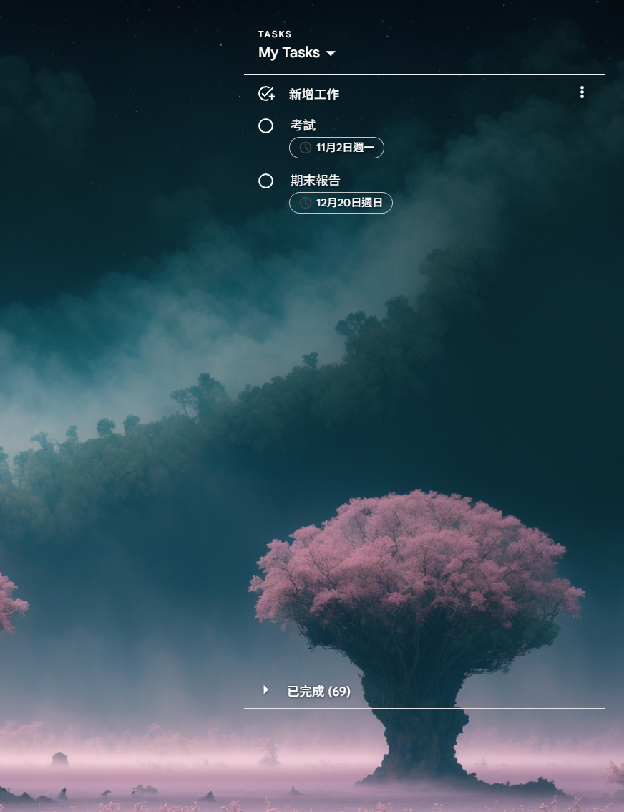

# Google Tasks Desktop — Transparent Windows Fork

[](https://github.com/howard-shi55/google-tasks-desktop/actions/workflows/build-windows.yml)

A **Windows x64 fork** of [shouryan01/google-tasks-desktop](https://github.com/shouryan01/google-tasks-desktop), maintained here by [howard-shi55](https://github.com/howard-shi55). It displays Google Tasks in a transparent, frameless window controlled from the system tray.

The original project and its Tauri-based web wrapper are by **Shouryan Nikam**. This fork adds Windows desktop-widget behavior; it is an unofficial app and is not affiliated with Google.

**Current release: [v0.1.8](https://github.com/howard-shi55/google-tasks-desktop/releases/tag/v0.1.8).**

## Screenshot



Screenshot provided for this fork. The desktop wallpaper shows through the transparent task surface.

## What changed from upstream?

Compared with the upstream code inherited by this fork:

| Area             | Inherited upstream behavior                    | This Windows fork                                                             |
| ---------------- | ---------------------------------------------- | ----------------------------------------------------------------------------- |
| Builds           | macOS and Windows publishing workflow          | Windows x64 only                                                              |
| Appearance       | Google Tasks' default web appearance           | Transparent surfaces, fixed white text and a subtle black text shadow         |
| Window chrome    | Native title bar and File/Edit/Window menu bar | Frameless window with no in-window menu bar or taskbar button                 |
| Controls         | Native window/menu controls                    | System-tray controls; drag empty space in the Tasks/My Tasks header           |
| Closing          | Normal window close                            | Close to tray; explicit Quit to exit                                          |
| Startup          | No tray startup toggle                         | Optional per-user Start at login checkbox                                     |
| Window placement | No app-managed position/size restore           | Remembers the last normal window position and size                            |
| Browser UI       | Default WebView browser behavior               | Browser context menus, DevTools, browser shortcuts and zoom controls disabled |

Both projects use Google's web interface inside Tauri. This fork does not implement a separate task-sync backend or require a Google API key. The upstream macOS CPU/RAM comparisons are not benchmarks of this Windows fork.

## Download and install

Requirements: **Windows 10/11 x64**, [Microsoft Edge WebView2 Runtime](https://developer.microsoft.com/en-us/microsoft-edge/webview2/), and a Google account to use Tasks.

Get the files from **[Releases](https://github.com/howard-shi55/google-tasks-desktop/releases/latest)**:

| File in v0.1.8                                                                                                                                             | Use                                                        |
| ---------------------------------------------------------------------------------------------------------------------------------------------------------- | ---------------------------------------------------------- |
| [`Google-Tasks_0.1.8_x64-setup.exe`](https://github.com/howard-shi55/google-tasks-desktop/releases/download/v0.1.8/Google-Tasks_0.1.8_x64-setup.exe)       | Recommended installer                                      |
| [`Google-Tasks_0.1.8_x64-portable.exe`](https://github.com/howard-shi55/google-tasks-desktop/releases/download/v0.1.8/Google-Tasks_0.1.8_x64-portable.exe) | Run without installing; keep it in a fixed folder          |
| [`google-tasks-windows-x64-v0.1.8.zip`](https://github.com/howard-shi55/google-tasks-desktop/releases/download/v0.1.8/google-tasks-windows-x64-v0.1.8.zip) | Original CI bundle containing the executable and installer |
| [`SHA256SUMS.txt`](https://github.com/howard-shi55/google-tasks-desktop/releases/download/v0.1.8/SHA256SUMS.txt)                                           | Checksums for the three downloads                          |

The release also includes [LICENSE.txt](https://github.com/howard-shi55/google-tasks-desktop/releases/download/v0.1.8/LICENSE.txt) with the original MIT notice.

Quit the previous version from its tray menu before updating. Launch the app and sign in to Google locally. Users do not need Rust, Bun, or Visual Studio to run a downloaded build. Windows binaries are unsigned.

The standalone executable uses the same per-user WebView profile and settings as the installed app; “portable” means no installation is required, not that all data lives next to the executable.

## Everyday use

- **Move:** drag empty space in the **Tasks / My Tasks header strip**. The list dropdown keeps its normal clicks.
- **Show/restore:** left-click the Google Tasks system-tray icon. Check the hidden-icons overflow if needed.
- **Hide:** choose **Hide** in the tray menu, or press **Alt+F4**.
- **Exit:** choose **Quit** in the tray menu. Hiding the window does not exit the app.
- **Reposition:** choose **Center** in the tray menu, including while on a sign-in page.

There is no Windows taskbar button. Right-click the **tray icon** for these controls:

| Location  | Actions                                            |
| --------- | -------------------------------------------------- |
| Top level | Show / Restore, Hide, Center, Start at login, Quit |
| Edit      | Undo, Redo, Cut, Copy, Paste, Select All           |
| Window    | Minimize, Toggle Full Screen                       |
| More      | About, Sign Out                                    |

For tray editing, select/focus the task input first. The app restores WebView focus and sends the corresponding native Ctrl shortcut. Sign Out opens Google's logout flow without forcibly terminating the app.

### Start at login

Check **Start at login** to launch the app when your Windows user signs in; uncheck it to stop. It is **opt-in**, needs no administrator rights, and is not enabled simply by opening the app. The app opens normally at login.

Enable it **after installing**, because the registration stores the path of the executable currently running. For a portable copy, toggle it off/on after moving the executable. The checkbox reflects the saved registration; a failed change restores the saved state and marks the item as **update failed**.

Normal uninstall removes the app's startup entry. Explicit updater-mode reinstalls preserve it; if you uninstall the old version before a manual reinstall, enable startup again afterward.

### Remembered position and size

The app saves its normal window bounds before hiding/quitting, on focus loss, and before entering fullscreen. On restart it restores the normal rectangle, rather than starting minimized, maximized, or fullscreen.

Windows adjusts completely offscreen saved positions after display changes. Invalid settings fall back to the default window. A DPI change can change the apparent logical size; **Center** is available from the tray.

### Browser menus and shortcuts

The WebView's default right-click menu, DevTools, browser accelerators and zoom controls are disabled, including browser refresh/print/save/navigation commands. **F1–F24** are intercepted inside the WebView; **Alt+F4** retains close-to-tray behavior.

Normal editing/navigation keys such as **Ctrl+C/V/X/A/Z**, Tab, Enter and arrow keys remain available. Google's own dropdowns/menus and the native tray menu still work. This does not intercept Windows-wide shortcuts.

### Language and appearance

- Google determines the Tasks interface language using its web/account preferences and WebView language preferences. This fork does not force a language.
- Tray labels are currently **English**, not automatically translated with Windows.
- The theme is fixed: white text, a subtle black shadow, and transparent page surfaces. Darker wallpapers provide better contrast.
- Floating menus, dialogs, listboxes and tooltips retain a dark background for readability.
- Google sign-in pages are not themed. Transparency does not enable click-through.

## Implementation notes and limitations

This app loads `https://tasks.google.com/embed/` and injects the theme only into Google's HTTPS Tasks embed routes, including `/embed/list/<id>`. Styles are reapplied after full navigation and apply to new elements within the same document.

Google controls the page. DOM/CSP changes can affect styling; styles do not cross iframe or shadow-root boundaries. The current draggable header is the **top 80 CSS pixels**, excluding interactive elements; a Google layout change may require adjusting that bound in `src-tauri/src/theme.js`.

Only native window dragging is granted to the remote Tasks origin. Tray actions, startup registration and placement persistence stay in Rust. The origin-level drag capability accommodates Tauri 2.0's Windows fetch IPC, which supplies an origin without the page path.

Per-user settings:

| Setting              | Registry location                                                                     |
| -------------------- | ------------------------------------------------------------------------------------- |
| Login startup        | Value `GoogleTasksDesktop` under `HKCU\Software\Microsoft\Windows\CurrentVersion\Run` |
| Normal window bounds | Value `WindowPlacementV1` under `HKCU\Software\GoogleTasksDesktop`                    |

The app uses WebView2's normal profile for Google sign-in. Sign-in and task data are handled by Google's web interface, not a replacement service operated by this fork.

## Build and verification

### GitHub Actions

No local native toolchain is needed for a cloud build:

1. Open this fork's **Actions** tab and enable workflows if prompted.
2. Select **Build Windows** → **Run workflow** → choose the branch.
3. After success, download **google-tasks-windows-x64** from the run's **Artifacts** section while signed in to GitHub.

The workflow is manual, Windows-only, and uses the committed dependency lockfiles. It runs the JS regression check, Rust check, Clippy and native tests before producing an NSIS installer and executable. Workflow artifacts expire after **14 days**; published Release downloads are separate from these temporary artifacts. The workflow does not automatically publish a Release.

### Local development on Windows

Use Rust's MSVC toolchain, Visual Studio C++ Build Tools with a Windows SDK, Node.js, WebView2, and **Bun 1.1.38** for the checked-in binary `bun.lockb`:

```powershell
bun install --frozen-lockfile
bun run tauri dev
```

Build the installer/executable:

```powershell
bun run tauri build --bundles nsis -- --locked
```

Checks:

```powershell
npm test
cargo check --manifest-path src-tauri/Cargo.toml --locked
cargo clippy --manifest-path src-tauri/Cargo.toml --locked --all-targets -- -D warnings
cargo test --manifest-path src-tauri/Cargo.toml --locked --lib
```

Tests cover embed-route isolation, idempotent theme/drag injection, IPC-origin permissions, function-key policy, startup registration and saved bounds. Registry tests use isolated temporary subtrees, not the real startup/settings entries. Native UI behavior still needs on-machine checks: sign-in, text editing, tray actions, disabled browser commands, move/resize → Quit → restart, and login startup.

## Credits and license

- Original project: [shouryan01/google-tasks-desktop](https://github.com/shouryan01/google-tasks-desktop), by **Shouryan Nikam**.
- Windows fork and screenshot: [howard-shi55](https://github.com/howard-shi55).
- Built with [Tauri](https://tauri.app/) and Microsoft Edge WebView2; task content comes from Google Tasks.

Licensed under the **[MIT License](LICENSE)**. The original copyright notice is preserved. Please report issues specific to this Windows fork in [this repository's issue tracker](https://github.com/howard-shi55/google-tasks-desktop/issues).
